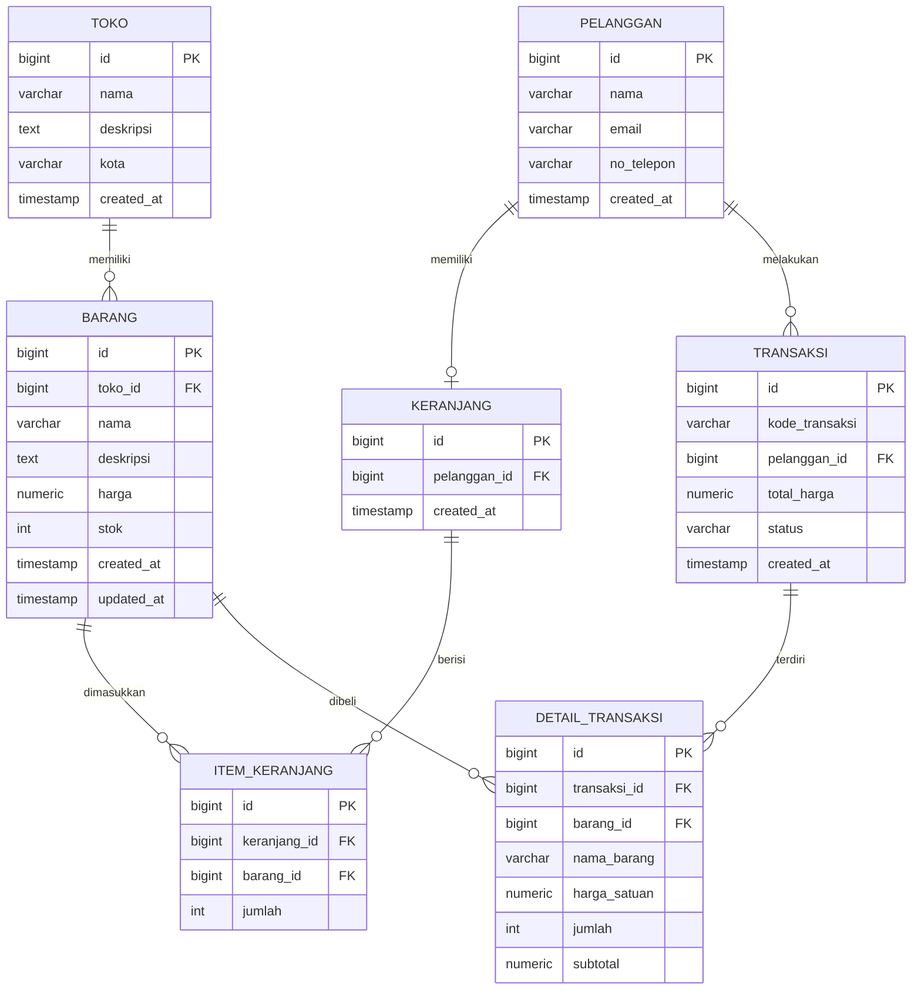

# Design Modules

Desain database dan modul untuk aplikasi e-commerce (ala Tokopedia).

## 1. Analisis Kebutuhan

Fitur berdasarkan skenario di soal:

| No | Fitur | Deskripsi |
|----|-------|-----------|
| 1 | Catalog | Pelanggan mencari produk di toko |
| 2 | Item | Melihat detail informasi produk |
| 3 | Cart | Menambahkan produk ke keranjang |
| 4 | Checkout / List Transaction | Setelah checkout, masuk daftar transaksi |
| 5 | Detail Transaction | Melihat detail sebuah transaksi |

Entitas yang perlu dipertimbangkan (silakan tambah/kurangi): Toko, Barang, Pelanggan, Keranjang, Item Keranjang, Transaksi, Detail Transaksi.

## 2. Pilihan Arsitektur

**Pilihan:** Modular monolith

Satu aplikasi Spring Boot dengan satu database PostgreSQL, tetapi kodenya dipisah rapi per modul.

**Alasan:**

- **Sesuai kebutuhan soal.** Soal meminta satu project monorepo dengan Spring Boot dan PostgreSQL.
- **Skala yang sesuai.** Fiturnya terbatas (catalog, item, cart, transaksi). Microservices akan menambah kerumitan (komunikasi antar layanan, konsistensi data, deployment) tanpa manfaat nyata pada skala ini.
- **Konsistensi data lebih mudah dijaga.** Proses checkout (cek stok, hitung total, simpan transaksi) melibatkan beberapa modul sekaligus. Dalam satu aplikasi, proses ini bisa dijalankan dalam satu transaksi database, sehingga data tidak setengah tersimpan.
- **Mudah dikembangkan.** Batas antar modul sudah jelas, sehingga jika aplikasi membesar, tiap modul bisa dipisah menjadi layanan tersendiri.

Skenario Tokopedia dipakai sebagai acuan fitur, bukan sebagai acuan arsitektur.

## 3. Pembagian Modul

| Modul | Tanggung jawab | Entitas utama |
|-------|----------------|---------------|
| `catalog` | Mengelola toko dan barang, pencarian produk, detail produk | Toko, Barang |
| `cart` | Mengelola keranjang belanja pelanggan | Keranjang, Item Keranjang |
| `transaction` | Checkout, daftar transaksi, detail transaksi | Transaksi, Detail Transaksi |

Pelanggan dipakai oleh modul `cart` dan `transaction` sebagai data dasar (tanpa autentikasi, karena tidak diminta di soal).

Aturan antar modul: `cart` dan `transaction` membaca data barang lewat service milik `catalog`, tidak langsung ke tabelnya. Dengan begitu batas modul tetap terjaga.

## 4. Desain Database (ERD)

## 5. Detail Tabel

Tipe data mengikuti PostgreSQL 15.

### `toko` (modul catalog)

| Kolom | Tipe | Constraint | Keterangan |
|-------|------|------------|------------|
| id | BIGINT | PK, identity | |
| nama | VARCHAR(150) | NOT NULL | Nama toko |
| deskripsi | TEXT | | Deskripsi toko |
| kota | VARCHAR(100) | | Lokasi toko |
| created_at | TIMESTAMP | NOT NULL | Waktu dibuat |

### `barang` (modul catalog)

| Kolom | Tipe | Constraint | Keterangan |
|-------|------|------------|------------|
| id | BIGINT | PK, identity | |
| toko_id | BIGINT | FK ke `toko`, NOT NULL | Toko pemilik barang |
| nama | VARCHAR(200) | NOT NULL | Nama barang |
| deskripsi | TEXT | | Detail informasi barang |
| harga | NUMERIC(15,2) | NOT NULL, harga >= 0 | Harga satuan |
| stok | INTEGER | NOT NULL, stok >= 0 | Jumlah stok |
| created_at | TIMESTAMP | NOT NULL | Waktu dibuat |
| updated_at | TIMESTAMP | NOT NULL | Waktu diubah |

### `pelanggan`

| Kolom | Tipe | Constraint | Keterangan |
|-------|------|------------|------------|
| id | BIGINT | PK, identity | |
| nama | VARCHAR(150) | NOT NULL | Nama pelanggan |
| email | VARCHAR(150) | NOT NULL, UNIQUE | Email pelanggan |
| no_telepon | VARCHAR(20) | | Nomor telepon |
| created_at | TIMESTAMP | NOT NULL | Waktu dibuat |

### `keranjang` (modul cart)

| Kolom | Tipe | Constraint | Keterangan |
|-------|------|------------|------------|
| id | BIGINT | PK, identity | |
| pelanggan_id | BIGINT | FK ke `pelanggan`, NOT NULL, UNIQUE | Satu pelanggan satu keranjang |
| created_at | TIMESTAMP | NOT NULL | Waktu dibuat |

### `item_keranjang` (modul cart)

| Kolom | Tipe | Constraint | Keterangan |
|-------|------|------------|------------|
| id | BIGINT | PK, identity | |
| keranjang_id | BIGINT | FK ke `keranjang`, NOT NULL | |
| barang_id | BIGINT | FK ke `barang`, NOT NULL | |
| jumlah | INTEGER | NOT NULL, jumlah > 0 | Jumlah barang yang ingin dibeli |

UNIQUE (`keranjang_id`, `barang_id`): barang yang sama tidak muncul dua kali di satu keranjang.

### `transaksi` (modul transaction)

| Kolom | Tipe | Constraint | Keterangan |
|-------|------|------------|------------|
| id | BIGINT | PK, identity | |
| kode_transaksi | VARCHAR(50) | NOT NULL, UNIQUE | Kode yang tampil di daftar transaksi |
| pelanggan_id | BIGINT | FK ke `pelanggan`, NOT NULL | |
| total_harga | NUMERIC(15,2) | NOT NULL | Total seluruh item saat checkout |
| status | VARCHAR(20) | NOT NULL | `DIPROSES`, `SELESAI`, `DIBATALKAN` |
| created_at | TIMESTAMP | NOT NULL | Waktu checkout |

### `detail_transaksi` (modul transaction)

| Kolom | Tipe | Constraint | Keterangan |
|-------|------|------------|------------|
| id | BIGINT | PK, identity | |
| transaksi_id | BIGINT | FK ke `transaksi`, NOT NULL | |
| barang_id | BIGINT | FK ke `barang`, NOT NULL | Referensi ke barang asal |
| nama_barang | VARCHAR(200) | NOT NULL | Salinan nama saat checkout |
| harga_satuan | NUMERIC(15,2) | NOT NULL | Salinan harga saat checkout |
| jumlah | INTEGER | NOT NULL, jumlah > 0 | |
| subtotal | NUMERIC(15,2) | NOT NULL | harga_satuan x jumlah |

## 6. Alasan Desain

- **Normalisasi:** data dipisah per entitas sehingga tidak ada pengulangan. Misalnya, informasi toko disimpan sekali di `toko`, bukan diulang di setiap barang.
- **Relasi dan foreign key:** foreign key menjaga integritas data, misalnya barang tidak bisa merujuk ke toko yang tidak ada.
- **Salinan nama dan harga di `detail_transaksi`:** harga barang bisa berubah setelah transaksi terjadi. Dengan menyimpan salinan nama dan harga saat checkout, riwayat transaksi lama tetap benar.
- **Constraint pada keranjang:** satu pelanggan hanya punya satu keranjang, dan satu barang hanya muncul sekali per keranjang (jumlahnya yang bertambah).
- **Stok dan checkout:** saat checkout, pengurangan stok, pembuatan transaksi, dan pengosongan keranjang dijalankan dalam satu transaksi database. Jika salah satu langkah gagal, semuanya dibatalkan.
- **Indeks:** foreign key seperti `barang.toko_id` diberi indeks untuk mempercepat penelusuran barang per toko, begitu juga `barang.nama` untuk pencarian di catalog.
- **Rencana pengembangan ke microservices:** tabel tiap modul (catalog, cart, transaction) sudah dikelompokkan, sehingga jika suatu saat dipisah, tiap kelompok bisa pindah ke database dan layanan sendiri. Karena itu modul `cart` dan `transaction` mengakses barang lewat service milik `catalog`, tidak langsung ke tabelnya.
